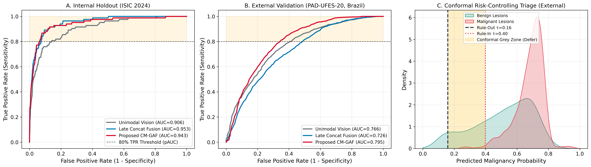

# CM-GAF: Uncertainty-Aware Cross-Modal Attention Fusion for Smartphone-Based Skin Cancer Triage

[](LICENSE)
[](https://www.python.org/)
[](https://pytorch.org/)

Official PyTorch implementation and reproducibility repository for the manuscript:
> **Uncertainty-Aware Cross-Modal Attention Fusion for Smartphone-Based Skin Cancer Triage: A Cross-Continental External Validation and Fairness Study on ISIC 2024 and PAD-UFES-20**

---

## Authors
1. **Dr. Juan Marcos Vilchez Canchari, PhD** *(First & Corresponding Author)* — Universidad César Vallejo, Lima, Peru (`jvilchezca@ucv.edu.pe`, ORCID: [`0000-0002-7758-7589`](https://orcid.org/0000-0002-7758-7589))
2. **Dra. Ruth Janett Palomino Rojas, PhD** — Universidad Privada San Juan Bautista, Lima, Peru (`ruthj.palomino@upsjb.edu.pe`, ORCID: [`0000-0003-1531-3408`](https://orcid.org/0000-0003-1531-3408))
3. **Dra. Mirian Corina Cribillero Roca, PhD** — Universidad Nacional del Callao, Callao, Peru (`mccribilleror@unac.edu.pe`, ORCID: [`0000-0003-4683-3633`](https://orcid.org/0000-0003-4683-3633))
4. **Dra. Luz Chavela De la Torre Guzmán, PhD** — Universidad Nacional del Callao, Callao, Peru (ORCID: [`0000-0001-9296-7355`](https://orcid.org/0000-0001-9296-7355))
5. **Dra. Vilma María Arroyo Vigil, PhD** — Universidad Nacional del Callao, Callao, Peru (ORCID: [`0000-0003-4235-7336`](https://orcid.org/0000-0003-4235-7336))

---

## Key Contributions & Features
- **Cross-Continental Clinical-Visual Harmonization:** Unified 13-dimensional clinical ontology (`age_years`, `diameter_mm`, `sex`, 8-category harmonized `anatom_site`, and explicit missingness indicators) bridging **ISIC 2024 SLICE-3D** ($N = 401,059$, multi-center North America/Europe/Oceania) and **PAD-UFES-20** ($N = 2,298$, mobile teledermatology cohort in Brazil).
- **Proposed `CM-GAF` Module (`cm_gaf_architecture.py`):** Combines $\tanh$-bounded Feature-wise Linear Modulation (FiLM), 4-head Cross-Modal Attention, and Adaptive Sigmoid Gating on top of a `convnext_tiny.fb_in22k` backbone (`timm`).
- **Mondrian Split Conformal Triage:** Finite-sample false-negative risk control ($\alpha_{\text{FN}} = 0.05$) evaluated under exchangeable holdout validation, zero-shot external transfer, and locally recalibrated Mondrian thresholds across Fitzpatrick skin phototypes I–VI (using pooled intermediate/dark phototype calibration for the sparse Fitzpatrick V–VI stratum, $n=11, n_1=1$).
- **Exact DeLong & Paired Bootstrap Statistical Suite:** Non-parametric 95% confidence intervals ($B = 1,000$ patient-clustered replicates) and exact two-sided DeLong test $p$-values.

---

## Visual Summary of Results



---

## Repository Contents

| File | Description |
| :--- | :--- |
| `cm_gaf_architecture.py` | Standalone PyTorch implementation of `CMGAFModel` (ConvNeXt-Tiny + FiLM + 4-head Cross-Modal Attention + Sigmoid Gated Residual Fusion) and Mondrian conformal quantile calibration. |
| `Q1_Multimodal_Derma_ISIC2024_PADUFES20_Colab.ipynb` | End-to-end training, cross-dataset ontology harmonization, ablation study, DeLong statistical testing, and fairness audit notebook executed on an NVIDIA L4 GPU. |
| `conformal_and_model_config.json` | Exact hyperparameter configuration, random seed (`seed = 42`), harmonized 13-D feature specification, and conformal calibration thresholds ($\hat{q}_{0.95}$). |
| `Table1_Ablation_Internal_and_External_ColabL4.csv` | Empirical internal holdout (ISIC 2024) and zero-shot external transfer (PAD-UFES-20) ablation metrics with 95% bootstrap CIs and exact two-sided DeLong $p$-values. |
| `Table2_Fairness_Fitzpatrick_PADUFES20_ColabL4.csv` | Fairness audit across Fitzpatrick phototypes I–II ($n=1,029$), III–IV ($n=454$), and V–VI ($n=11$) before and after local Mondrian conformal recalibration. |
| `Figure1_Q1_Multimodal_Triage_Results.png` | Multi-panel publication figure (ROC curves, pAUC@80% specificity, Fitzpatrick fairness audit, and conformal sensitivity trade-off). |
| `requirements.txt` | Python package dependencies for full reproducibility. |

---

## Quickstart

### 1. Install Dependencies
```bash
pip install -r requirements.txt
```

### 2. Instantiate and Test the `CM-GAF` Architecture
```bash
python cm_gaf_architecture.py
```

### 3. Datasets
- **ISIC 2024 SLICE-3D Challenge Dataset:** Publicly available at [https://www.kaggle.com/competitions/isic-2024-challenge](https://www.kaggle.com/competitions/isic-2024-challenge)
- **PAD-UFES-20 Dataset (Pacheco et al., 2020):** Publicly available at Mendeley Data [https://data.mendeley.com/datasets/zr7vgbcyr2/1](https://data.mendeley.com/datasets/zr7vgbcyr2/1) (DOI: `10.17632/zr7vgbcyr2.1`)

---

## License
This project is licensed under the MIT License — see the [LICENSE](LICENSE) file for details.
